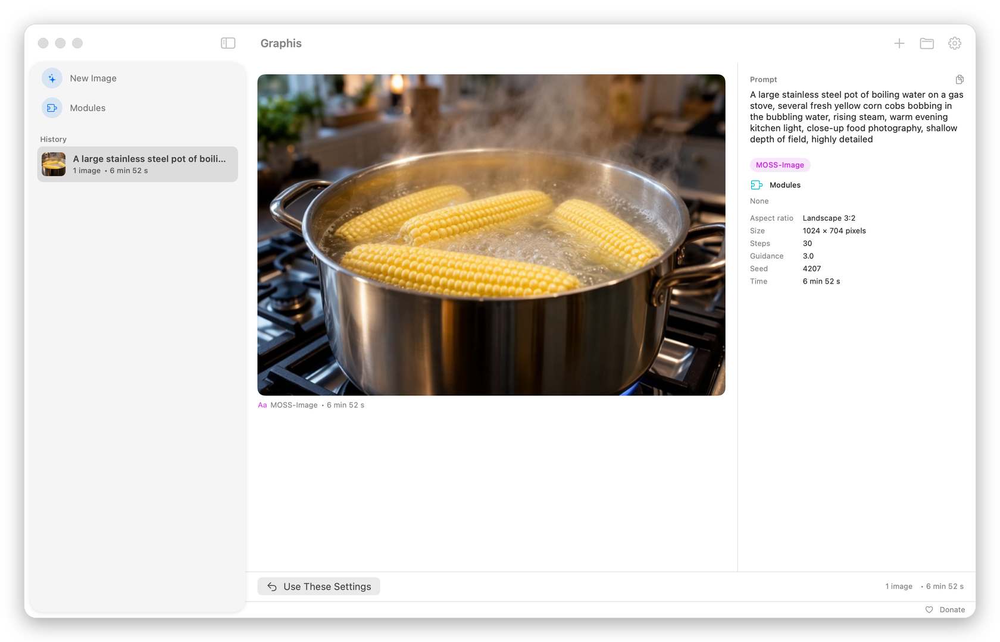
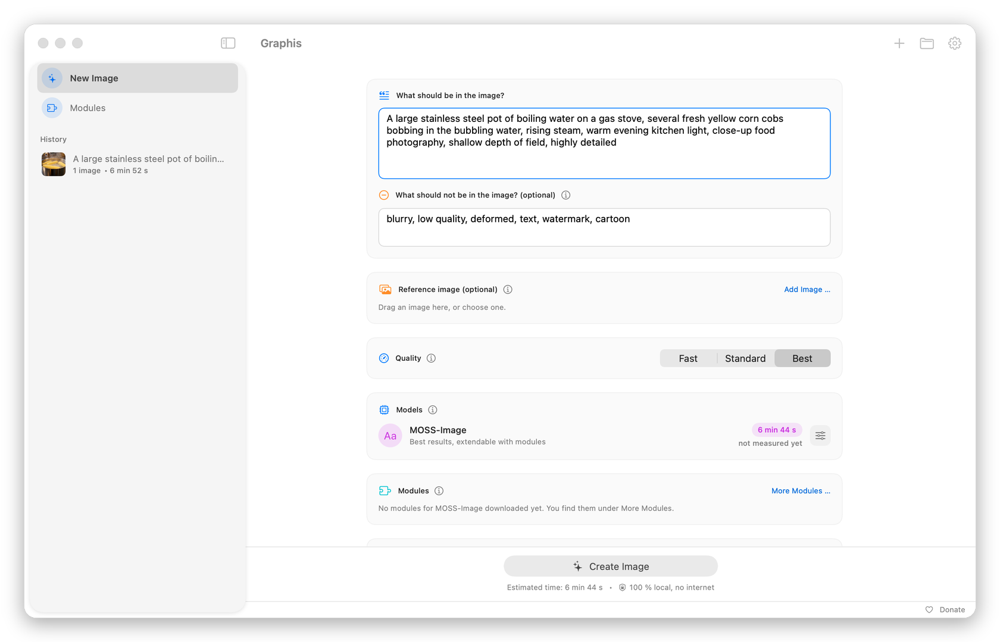

# Graphis

Graphis turns a text description into an image, entirely on your Mac. It runs the open MOSS-Image model (Apache 2.0) through mflux and Apple's MLX. Your prompts and images never leave the computer. The app speaks English and German and follows your Mac's language.

**Uncensored.** MOSS-Image has no built-in content filter, and Graphis adds none: prompts are not checked and images are not blocked. According to the model's technical report, its training data was not filtered beyond the checks the source datasets already applied.

The name comes from the Greek γραφίς: stylus, brush.



## What it does

- Images from a prompt and a negative prompt, in five formats and up to 1280 pixels
- Three quality levels from Fast (with the turbo module) to Best, or your own values for steps and guidance
- A reference image as a template, with a slider for how closely to follow it
- Modules (LoRA files) for style, light and detail: a small catalog of checked modules, or your own files
- A queue that keeps going after a restart, and a time estimate that gets more accurate with every image
- Reuse the settings of a finished image to change one thing at a time



## Requirements

- A Mac with Apple Silicon (M1 or newer)
- macOS 26.2 or later. The MLX compute library requires it.
- About 17 GB of free disk space: 15.2 GB for the model and the turbo module, plus some headroom
- Memory: 24 GB or more recommended. The model uses about 14 GB; 16 GB is untested.

## Install

1. Download `Graphis-<version>.zip` from [Releases](https://github.com/Campfire7/graphis/releases) and double-click to unzip it.
2. Drag `Graphis.app` into your Applications folder.
3. Graphis is only ad hoc signed and not notarized by Apple. The first time you open it, macOS says it cannot verify the app. Open **System Settings > Privacy & Security**, scroll down to the message about Graphis, click **Open Anyway** and confirm.
4. If that does not work, allow just this one app in Terminal, then open it normally:

   ```bash
   xattr -dr com.apple.quarantine /Applications/Graphis.app
   ```

## First start

Under **New Image** you will see the card **Set Up MOSS-Image** with the download size and your free space. Nothing is downloaded until you click **Download**. Graphis then fetches the model (mflux-community/moss-image-sft-mflux-q8) and the turbo module (lodestones/MOSS-Image-SFT-8-steps-dmd) from Hugging Face, both pinned to a fixed revision, and checks every file against its SHA-256. If the download stops or you quit the app, **Resume** continues where it left off. The model is activated only once everything checks out. After that, Graphis works without the internet.

Graphis also asks once: **Check for new versions automatically?** See Privacy below.

**Settings > General > Check Model Files** re-checks the model files at any time. **Repair** under New Image downloads damaged files again and keeps the good ones.

## Privacy

- Prompts and images stay on your Mac. There is no account, no cloud, no analytics and no logging.
- Graphis goes online when you click to download the model or a module (exactly those files, from Hugging Face), and for the update check if you allowed it. The update check asks GitHub at most once a day whether a newer release exists and sends nothing about you or your images. You can change this anytime under **Settings > General > New Versions**. If a new version exists, Graphis shows a note with a link. It never downloads or installs anything by itself.
- **Donate** only opens your browser.
- The prompt reaches the compute engine through a file, not through the process list. Images contain no embedded prompt or settings.

| What | Where |
|---|---|
| Images, their details and the queue | `~/Downloads/Graphis/` |
| Model, modules and time-estimate data | `~/Library/Application Support/Graphis/` |
| Licenses of the bundled components | in the app under Settings > General > Show Licenses |

## Donate

Graphis is free software and costs nothing. If you would like to support its development, donations are welcome:

| Currency | Address |
|---|---|
| Bitcoin | `bc1qkgj6wl5sv3yel0v34mexalcesms580367slk9h` |
| Monero | `4AbFvwrC5oEDfZQZoXBMBKia3njagBYeTTbx9sXj7mRCYFxNxnSCDFmVtqRkHvSbUZ8u1xiQDghKv5d7iCd8heu9JcLDc1H` |

Bitcoin payments are publicly visible; Monero keeps sender and amount private.

## Build from source

You need a Mac with Apple Silicon, the Xcode Command Line Tools (`xcode-select --install`), [uv](https://docs.astral.sh/uv/) and an internet connection for the first build.

```bash
zsh bauen.sh
```

This builds `dist/Graphis.app` and `dist/Graphis-<version>.zip`, never into an Applications folder. Python (python-build-standalone 3.12.16, release 20261026) and the 42 packages in `motor/anforderungen-moss.txt` are pinned with SHA-256 and cached in `.build/downloads` on the first build. torch, OpenCV and matplotlib are left out on purpose; the MOSS-Image path does not need them. Every Mach-O file is ad hoc signed on its own, from the inside out. All files in the bundle get the same fixed timestamp, and the ZIP contains no extended attributes and no user IDs. `THIRD_PARTY_NOTICES.txt` is regenerated from what is actually in the bundle. Set another version with `GRAPHIS_VERSION=1.1 zsh bauen.sh`.

Four packages (hf-xet, hf-transfer, safetensors, tokenizers) contain Rust code with further libraries and the Rust standard library statically linked in. Their list and license texts live in `motor/rust-lizenzen.json`, each library verified with its SHA-256 from crates.io. If one of these binaries changes, the build stops until the file is regenerated. That takes a freshly assembled engine, internet access and cargo:

```bash
ARBEIT="$(mktemp -d)" && zsh motor/bereitstellen.sh "$ARBEIT/Motor" "$PWD/.build/downloads" \
  && /usr/bin/python3 -I -B motor/rust_lizenzen.py "$ARBEIT/Motor" .build/downloads motor/rust-lizenzen.json
[ -n "$ARBEIT" ] && rm -rf "$ARBEIT"
```

Project layout (file and folder names are German):

| Folder | Contents |
|---|---|
| `App/` | The app's Swift and SwiftUI sources, no Xcode project, plus the translations |
| `motor/` | Launcher and reference path for mflux, package list, tools to build, license and check the engine |
| `tests/` | Test program, test server, test data and a stand-in for the engine |
| `werkzeug/` | Draws the app icon if `App/AppIcon.icns` is missing |

## Tests

```bash
zsh tests/testlauf.sh
```

This builds a separate test program from the app's sources, without the app's entry point, and runs it against a local test server. Instead of the compute engine it calls a stand-in that records the arguments. It opens no window, needs neither GPU nor internet, and works only in its own folders under the temporary directory. It covers model setup (19 cases such as resuming, repair, bad server responses and low disk space, plus a restart in the middle of a download), the queue, the reference image, detecting and loading modules, saved data with unknown or missing values, the update check, and that every text in the app has its German translation. The exit status is 0 only if everything passes. Run single parts with e.g. `zsh tests/testlauf.sh module`. The test server runs with `/usr/bin/python3`; set another Python with `PYTHON=…`.

The test hooks exist only in the test program (flag `TESTLAUF`); the app itself has no test mode. Two kinds run only by hand: `zsh tests/testlauf.sh ansichten` draws the interface in English and German as PNG files, and `GRAPHIS_SCREENSHOT_BILD=<image.png> zsh tests/testlauf.sh screenshots` draws the screenshots in `docs/`.

`motor/motorpruefung.py` checks the engine in the finished bundle without generating an image. It loads MLX on the CPU only and needs the model's `tokenizer/` folder:

```bash
dist/Graphis.app/Contents/Resources/Motor/python/bin/python3.12 -I -B motor/motorpruefung.py \
  dist/Graphis.app/Contents/Resources/Motor <folder containing the model's tokenizer/> <test image.png>
```

Real images are only generated in the app itself.

## Licenses

- The Graphis code is under the MIT license, see `LICENSE`.
- Python and the bundled packages are under their own licenses, see `THIRD_PARTY_NOTICES.txt`. This includes the Rust libraries statically linked into some packages. The file is also inside the app bundle.
- The model and modules are not in the ZIP. The app downloads them only when you click, from Hugging Face, all pinned to a fixed revision and, according to their model cards, under Apache 2.0. They are listed in `THIRD_PARTY_NOTICES.txt` as well.
- Modules you add yourself come with their own license. Check it before use.

## Responsibility

Graphis is a tool. You are responsible for the images you create with it and for how you use them. Respect the rights of others, for example to people, trademarks and works, and the licenses of models and modules. The software comes without warranty, see `LICENSE`.
